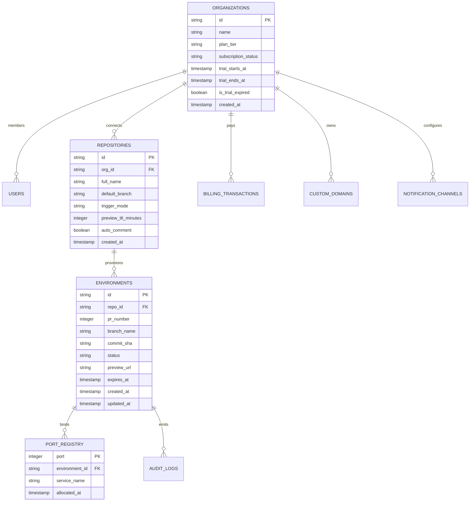
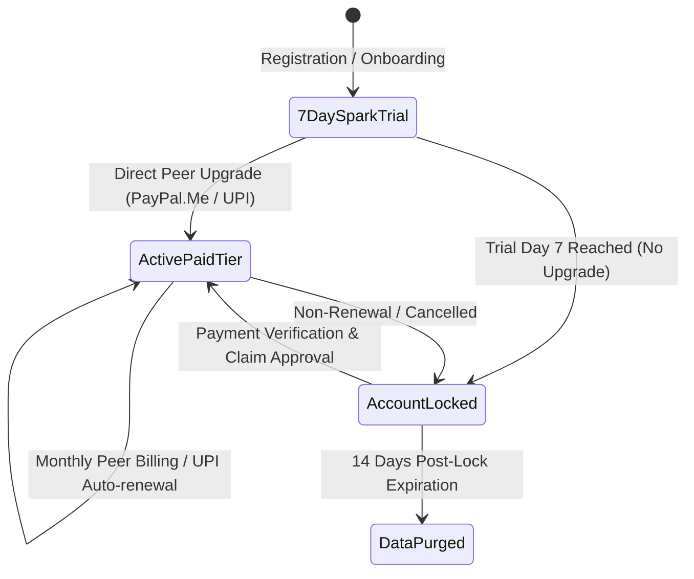
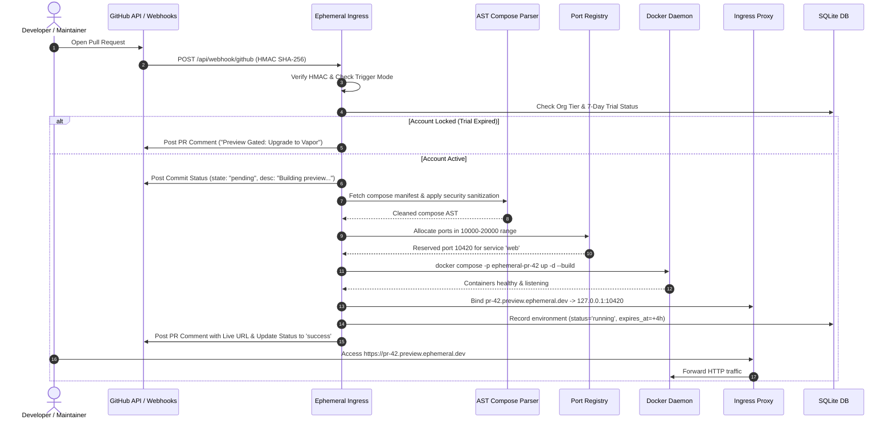

# Ephemeral PR Preview Orchestrator — Comprehensive Architecture & System Design

> **Official SaaS Platform:** [**https://ephemeral.peaklabs.in**](https://ephemeral.peaklabs.in)  
> [← Main Documentation](README.md) • [API Specification](API_SPEC.md) • [Backend Guide](app/README.md) • [Frontend Web App](app/web/README.md) • [Security Policy](SECURITY.md)

---

## 1. System Overview & Executive Summary

**Ephemeral** is an enterprise-grade, autonomous, multi-tenant pull request and branch preview orchestration engine. It transforms developer velocity by automatically instantiating fully isolated, network-partitioned container environments for every GitHub Pull Request, branch push, or manual developer trigger — completely eliminating the necessity for complex Kubernetes clusters, expensive preview SaaS subscriptions, or manual staging maintenance.

```mermaid
graph TD
    subgraph GitHub Ecosystem
        DEV[Developer Git Action] -->|pull_request.opened / synchronize| WH[GitHub Webhooks]
        DEV -->|push branch commit| WH
        DEV -->|issue_comment: /preview deploy| WH
    end

    subgraph Ephemeral Ingress & Security Boundary
        WH -->|HTTPS POST /api/webhook/github| FASTIFY[Fastify 5.x Ingress]
        FASTIFY -->|HMAC-SHA256 Verification| SEC_GW[Security Gateway]
        SEC_GW -->|Disposable Email / Tenant Check| AUTH_VAL[Tenant & Abuse Validator]
        SEC_GW -->|Trigger Mode Evaluator| TRIG_DEC[Trigger Orchestrator]
    end

    subgraph Container Orchestration Engine
        TRIG_DEC -->|Git Shallow Fetch / Archive| COMP_PARSER[AST Compose Sanitizer]
        COMP_PARSER -->|Security Strip & Sandbox Rulebook| SAN_SPEC[Sanitized Compose AST]
        SAN_SPEC -->|Port Request 10000-20000| PORT_MGR[Atomic Port Allocator]
        PORT_MGR -->|Transaction Lock| DOCKERODE[Docker Runtime / Engine]
        DOCKERODE -->|Isolated Bridge Network| PREVIEW_STACK[Multi-Container Stack]
    end

    subgraph Networking & Ingress Routing
        PREVIEW_STACK -->|Local Host Port| TUNNEL_MGR[Tunnel & Proxy Ingress]
        TUNNEL_MGR -->|Cloudflare / Tailscale / Ngrok / Reverse Proxy| PUB_URL[Secure Preview URL]
        TUNNEL_MGR -->|Custom Domain Router| CUSTOM_DNS[pr-*.customerdomain.com]
    end

    subgraph Telemetry, Daemon & Feedback
        PUB_URL -->|Post PR Comment & Commit Status| GH_API[GitHub REST API]
        DOCKERODE -->|stdout / stderr stream| LOG_SRV[Real-Time WebSocket Log Stream]
        CLEANUP[Autonomous GC Daemon] -->|Every 60s Check TTL & Expired Trials| DOCKERODE
        DB[(SQLite WAL + Memory Cache)] <--> FASTIFY
    end
```

---

## 2. Core Architectural Principles

Ephemeral is built around four foundational principles:

1. **Zero-Trust Multi-Tenancy**: Every container environment must operate under absolute hardware and networking constraints. Containers cannot talk to host daemon sockets, neighbor environments, or private cloud VPC interfaces.
2. **Ephemeral Lifecycle & Zero Persistence**: Code, database seeds, and assets spun up for a preview exist only for the lifetime of the preview. Upon PR close, branch deletion, or TTL expiration, all containers, networks, volumes, and ports are immediately nuked and reclaimed.
3. **Deterministic Isolation**: AST-level Docker Compose rewriting prevents malicious or misconfigured compose manifests from taking down the host system.
4. **Frictionless Developer Experience**: Developers need zero configuration beyond a standard `docker-compose.yml` or repo code. Environments can be commanded directly from GitHub PR comments via slash commands (`/preview deploy`, `/preview destroy`, `/preview logs`, `/preview restart`, `/preview extend 4h`) or triggered from a web console.

---

## 3. Subsystem Breakdown

### 3.1 Webhook Ingress & Verification Subsystem (`app/src/github/webhook-handler.ts`)

The ingress gateway processes incoming webhooks from GitHub with strict cryptographic and protocol checks:

- **Cryptographic Signature Verification**: Validates the `X-Hub-Signature-256` header against `process.env.GITHUB_WEBHOOK_SECRET` using timing-safe buffer comparison (`crypto.timingSafeEqual`) to prevent timing attacks.
- **Event Multiplexing**: Handles:
  - `pull_request`: `opened`, `synchronize`, `reopened`, `closed`, `labeled`.
  - `push`: Evaluates branch patterns (e.g. `feature/*`, `staging`) if continuous branch previews are configured.
  - `issue_comment`: Parses comments on pull requests for administrative slash commands.
  - `pull_request_review`: Validates approved reviews when approval gating is enabled.
- **Deduplication & Replay Protection**: Employs an in-memory sliding window and database unique index on `(repo_full_name, delivery_id)` to discard duplicate GitHub webhook retries.

### 3.2 Trigger Modes & Orchestration Engine

Ephemeral supports three distinct triggering workflows:

| Trigger Mode | Description | Configuration | Execution Mechanism |
| :--- | :--- | :--- | :--- |
| **Automatic PR** | Spins up or synchronizes preview on every PR open or commit push. | Repository Settings: `trigger_mode = 'auto_pr'` | GitHub Webhook `pull_request.opened` / `synchronize` |
| **Continuous Branch Push** | Automatically previews specific branches (e.g., `main`, `dev`, `release/*`) on every push. | Repository Settings: `trigger_mode = 'branch_push'` | GitHub Webhook `push` event |
| **On-Demand / Manual** | Previews are only built when explicitly requested by an authorized maintainer. | Repository Settings: `trigger_mode = 'on_demand'` | UI Modal (`+ Deploy Preview`) or PR comment `/preview deploy` |

#### Supported Slash Commands:
- `/preview deploy` — Immediately queues or rebuilds the current pull request branch.
- `/preview destroy` — Immediately tears down running containers, frees ports, and destroys ingress.
- `/preview logs` — Posts the last 50 lines of container build and runtime logs as a PR comment reply.
- `/preview restart` — Restarts the container stack without rebuilding image caches.
- `/preview extend 4h` — Extends preview TTL by up to 4 hours (subject to tier maximums).

### 3.3 Multi-Tenant Isolation & AST Compose Sanitizer (`app/src/docker/compose-parser.ts`)

Developer repositories frequently contain untrusted or developer-specific Docker Compose directives. Ephemeral parses the YAML AST and applies deterministic sanitization rules before execution:

1. **Privilege Stripping**:
   - `privileged: true` is strictly rewritten to `privileged: false`.
   - Security capabilities (`cap_add`) are stripped, allowing only unprivileged container execution (`CAP_NET_BIND_SERVICE` if necessary).
   - Linux namespaces (`pid: "host"`, `network_mode: "host"`, `ipc: "host"`) are blocked and replaced with private bridge isolation.
2. **Mount Filtering & Dangerous Volume Blacklisting**:
   - Docker daemon socket mounts (`/var/run/docker.sock`) are completely blocked.
   - Host filesystem root mounts (`/`, `/etc`, `/sys`, `/proc`, `/var`) are forbidden.
   - Any volume mount not pointing to a recognized project subdirectory is stripped.
3. **Resource Capping**:
   - Injects hard memory limits (e.g., `mem_limit: 2048m`) and CPU quotas (`cpus: 1.5`) per container based on the customer's subscription tier.
   - Injects restart policies to `restart: "on-failure:3"` to prevent infinite crash-restart loops from saturating CPU resources.
4. **Network Partitioning**:
   - Each preview deployment generates a unique Docker bridge network: `ephemeral-net-pr-{env_id}`.
   - Inter-container communication is restricted exclusively to containers inside that specific preview stack.

### 3.4 Atomic Port Allocator (`app/src/docker/port-allocator.ts`)

Ephemeral manages an atomic port registry in SQLite (`port_registry`) within the port range `10000–20000`:

```sql
CREATE TABLE IF NOT EXISTS port_registry (
    port INTEGER PRIMARY KEY,
    environment_id TEXT NOT NULL,
    service_name TEXT NOT NULL,
    allocated_at TIMESTAMP DEFAULT CURRENT_TIMESTAMP,
    FOREIGN KEY(environment_id) REFERENCES environments(id) ON DELETE CASCADE
);
```

- **Concurrency Handling**: Port allocation executes inside a serialized SQLite transaction (`BEGIN IMMEDIATE`). It finds the lowest unallocated port not currently bound in the database AND verifies port vacancy on the host system via a TCP socket probe.
- **Deallocation & Cascading Cleanup**: When an environment status changes to `destroyed`, all associated ports are freed atomically in the same database transaction.

### 3.5 Ingress Routing & Custom Vanity Domains

Ephemeral supports multiple routing backends to deliver zero-friction preview URLs:

1. **Subdomain Ingress**:
   - Format: `https://pr-{number}-{repo_short}.preview.ephemeral.dev`
   - Reverse proxy routes inbound traffic to the allocated host port via Nginx / Traefik / Caddy.
2. **Zero-Config Tunnels**:
   - Supports Cloudflare Named Tunnels (`cloudflared`), Tailscale Funnel, and Ngrok integration for local/on-premise preview deployments behind NATs.
3. **Custom Vanity Domains (`app/src/domains/service.ts`)**:
   - Enterprise and Stratum tiers can map custom domains (e.g., `*.preview.acme.corp`).
   - Automated DNS verification verifies CNAME records using Node.js `dns.promises.resolveCname` against Ephemeral's cluster edge.

### 3.6 Autonomous Garbage Collection Daemon (`app/src/daemon/cleanup-daemon.ts`)

The background cleanup daemon runs on an asynchronous cron loop every 60 seconds:

1. **TTL Expiration Scanning**:
   - Queries `SELECT * FROM environments WHERE status IN ('running', 'provisioning') AND expires_at <= CURRENT_TIMESTAMP`.
   - Executes non-blocking teardown: stops containers, destroys network bridge, releases ports, archives build logs.
2. **Trial Lifecycle & Account Lock Enforcement**:
   - Scans organizations on the `spark` tier where `trial_ends_at <= CURRENT_TIMESTAMP`.
   - Marks accounts as locked (`is_trial_expired = 1`).
   - Automatically pauses or destroys active preview instances to preserve host resources.
   - Gates further deployments behind the upgrade paywall.
3. **Orphaned Container & Prune Sweep**:
   - Matches Docker engine container labels (`com.ephemeral.managed=true`) against active database environment IDs.
   - Purges any dangling containers, bridge networks, or untagged build caches older than 24 hours.

### 3.7 In-Memory Caching Architecture (`app/src/cache/lru-cache.ts`)

Ephemeral uses an in-memory high-throughput LRU/TTL cache layer to shield SQLite from hot-path API reads:

- **Key Spaces**:
  - `health:*` — Global system health and container metric aggregates (TTL: 5s).
  - `billing:org:*` — Subscription status, tier limits, and trial countdowns (TTL: 60s, invalidated on payment event).
  - `domains:*` — Active custom domain routing tables (TTL: 300s).
- **Eviction Policy**: Least-Recently-Used eviction when entry count exceeds `maxEntries: 1000`.

### 3.8 Anti-Abuse & Disposable Email Gateway (`app/src/security/disposable-email-validator.ts`)

To protect server compute from cryptomining botnets and sybil free-tier abuse:

- Gated signups against a consolidated database of 3,500+ disposable/burner email domains (e.g., `mailinator.com`, `tempmail.com`, `10minutemail.com`, `guerrillamail.com`).
- RFC 5322 regex validation and MX record DNS resolution to ensure domain legitimate mail deliverability.

---

## 4. Database Architecture & Schema

Ephemeral utilizes SQLite 3 with Write-Ahead Logging (`PRAGMA journal_mode = WAL;`) and synchronous normal mode (`PRAGMA synchronous = NORMAL;`) for microsecond-level query latencies.

### Database ER Diagram



---

## 5. Subscription Tiers & Billing Lifecycle



| Tier Name | Price | Concurrent Previews | Compute / Memory Limits | Ingress Type | Max TTL | Idle Spin-down |
| :--- | :--- | :--- | :--- | :--- | :--- | :--- |
| **Spark (Trial)** | Free (7 Days) | 2 Previews | 1 vCPU / 2GB RAM per stack | Shared Subdomain | 4 Hours | 30 Minutes |
| **Vapor** | $39 / mo | 6 Previews | 2 vCPU / 4GB RAM per stack | Vanity Ingress + SSL | 12 Hours | 45 Minutes |
| **Stratum** | $129 / mo | 20 Previews | 4 vCPU / 8GB RAM per stack | Custom Domains + Wildcard | 24 Hours | 3 Hours |
| **Apex** | $349 / mo | Unlimited | 8 Dedicated vCPU / 16GB RAM | Dedicated VPC Runner | Indefinite | Never (Always-on) |

---

## 6. End-to-End Deployment Sequence



---

## 7. Security Hardening & Threat Model

| Threat Vector | Mitigation Strategy | Implemented Component |
| :--- | :--- | :--- |
| **Container Breakout** | Strip `privileged`, drop `CAP_SYS_ADMIN`, enforce user namespace mapping, restrict seccomp profile. | `app/src/docker/compose-parser.ts` |
| **Host Socket Poisoning** | Regex and AST parse bans for `/var/run/docker.sock` and host `/etc`, `/proc`. | `app/src/docker/compose-parser.ts` |
| **Port Collision Attacks** | Atomic SQLite transactions on `port_registry` with immediate write locking and TCP socket verification. | `app/src/docker/port-allocator.ts` |
| **Cryptomining & Sybil Abuse**| Strict 7-day trial limits, disposable email domain blacklist, concurrency caps, CPU throttling. | `app/src/security/disposable-email-validator.ts` |
| **Timing Attacks on Webhooks** | Constant-time HMAC comparison using `crypto.timingSafeEqual`. | `app/src/github/webhook-handler.ts` |
| **IDOR & Cross-Tenant Access** | Tenant scoped queries (`WHERE org_id = ?`) enforced in API route layer with JWT claims. | `app/src/api/routes.ts` |
| **Resource Starvation / DoS** | Background cleanup daemon actively reaps containers exceeding TTL or memory limits every 60s. | `app/src/daemon/cleanup-daemon.ts` |
