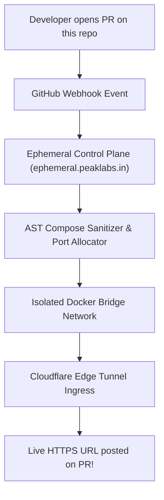

<div align="center">

# ⚡ Ephemeral Preview Demo

### Official Demonstration & Test Repository for Ephemeral Full-Stack PR Previews

> *"Experience instant, isolated Docker Compose preview environments on every GitHub Pull Request and branch commit."*

[-gold?style=for-the-badge&logo=github&logoColor=black)](https://github.com/mehaksandhudev)
[](https://ephemeral.peaklabs.in)
[](https://ephemeral.peaklabs.in)
[](https://paypal.me/mhksandhu)
[](https://buymeacoffee.com/mehaksandhudev)

[](https://www.docker.com/)
[](LICENSE)

**🌐 Live Production Platform:** [**https://ephemeral.peaklabs.in**](https://ephemeral.peaklabs.in)

[Live SaaS](https://ephemeral.peaklabs.in) • [Architecture](ARCHITECTURE.md) • [API Spec](API_SPEC.md) • [Security Policy](SECURITY.md) • [Terms & AUP](TERMS_AND_AUP.md) • [Privacy Policy](PRIVACY_POLICY.md)

</div>

---

## 📑 Table of Contents

- [⚡ What is this Repository?](#-what-is-this-repository)
- [🚀 How Ephemeral Works with this Repository](#-how-ephemeral-works-with-this-repository)
- [🎯 Interactive In-PR Slash Commands](#-interactive-in-pr-slash-commands)
- [🐳 Docker Compose Architecture](#-docker-compose-architecture)
- [📚 Complete Documentation Suite](#-complete-documentation-suite)
- [☕ Support & Donations](#-support--donations)
- [👩‍💻 Author](#-author)
- [📄 License](#-license)

---

## ⚡ What is this Repository?

This is the **official demonstration repository** designed to showcase the automated pull request preview lifecycle of the **[Ephemeral Orchestrator](https://ephemeral.peaklabs.in)**.

Whenever a developer opens a Pull Request or pushes a commit to a feature branch in this repository, Ephemeral automatically:
1. Ingests the GitHub webhook payload (`pull_request.opened` or `synchronize`).
2. Validates the `docker-compose.yml` manifest using AST-level security sanitization.
3. Allocates atomic, collision-free host ports (`10000–20000`).
4. Provisions an isolated container bridge network (`ephemeral-net-pr-{id}`).
5. Establishes a zero-config encrypted HTTPS ingress tunnel via Cloudflare.
6. Posts a live preview URL directly as a comment on the pull request!

---

## 🚀 How Ephemeral Works with this Repository



---

## 🎯 Interactive In-PR Slash Commands

Maintainers and collaborators can manage previews directly from GitHub PR discussion comments:

| Slash Command | Action Executed by Ephemeral Bot |
| :--- | :--- |
| `/preview deploy` | Immediately triggers an on-demand build of the pull request branch. |
| `/preview destroy` | Immediately tears down running preview containers and reclaims host ports. |
| `/preview logs` | Fetches the last 50 lines of container build/runtime logs and replies in the PR. |
| `/preview restart` | Gracefully restarts the container stack without rebuilding image caches. |
| `/preview extend 4h` | Extends the active preview's Time-To-Live (TTL) by 4 hours. |

---

## 🐳 Docker Compose Architecture

This repository uses a lightweight, self-contained multi-tier definition in [`docker-compose.yml`](docker-compose.yml):

```yaml
services:
  web:
    image: nginxdemos/hello:plain-text
    ports:
      - "80"
```

Ephemeral automatically detects the exposed port, dynamically rewrites host bindings to an unallocated port in the `10000–20000` pool, and routes incoming traffic seamlessly.

---

## 📚 Complete Documentation Suite

All system documentation, architecture diagrams, API specifications, and legal governance policies are bundled directly in this repository:

| Document | Focus & Scope | Direct Link |
| :--- | :--- | :--- |
| **System Architecture** | Subsystem design, AST compose sanitizer, atomic port allocator, and sequence diagrams. | [`ARCHITECTURE.md`](ARCHITECTURE.md) |
| **API Specification** | Complete Fastify REST endpoints, WebSocket log streaming, and trigger schemas. | [`API_SPEC.md`](API_SPEC.md) |
| **Security Policy** | Vulnerability disclosure SLAs, kernel capability drops, and container sandboxing. | [`SECURITY.md`](SECURITY.md) |
| **Terms of Service & AUP** | Enterprise legal contract, acceptable use policy, and 7-day Spark trial terms. | [`TERMS_AND_AUP.md`](TERMS_AND_AUP.md) |
| **Privacy Policy** | GDPR, CCPA, and India DPDP compliance with zero-persistence source code guarantees. | [`PRIVACY_POLICY.md`](PRIVACY_POLICY.md) |

---

## ☕ Support & Donations

If Ephemeral saves your engineering team hours of manual staging maintenance, accelerates your code reviews, or simplifies your preview infrastructure, consider supporting development:

[](https://paypal.me/mhksandhu)
[](https://buymeacoffee.com/mehaksandhudev)

- **PayPal**: [https://paypal.me/mhksandhu](https://paypal.me/mhksandhu)
- **Buy Me A Coffee**: [https://buymeacoffee.com/mehaksandhudev](https://buymeacoffee.com/mehaksandhudev)
- **UPI (India)**: `ephemeral@okaxis`

---

## 👩‍💻 Author

**Mehak Sandhu**  
*Full-Stack Systems Architect & Quantitative Engineer*  
*Amritsar, Punjab, India 🇮🇳*

- 🌐 **Portfolio**: [mehak-sandhu.in](https://www.mehak-sandhu.in)
- 🐙 **GitHub**: [@mehaksandhudev](https://github.com/mehaksandhudev)
- 📧 **Contact**: [mehaksandhudev@gmail.com](mailto:mehaksandhudev@gmail.com) • [info@mehak-sandhu.in](mailto:info@mehak-sandhu.in)

---

## 📄 License

Distributed under the **MIT License**.

---

<div align="center">

Crafted with ❤️ by **[Mehak Sandhu](https://github.com/mehaksandhudev)** • [Portfolio](https://www.mehak-sandhu.in) • [Live Platform](https://ephemeral.peaklabs.in)

</div>
