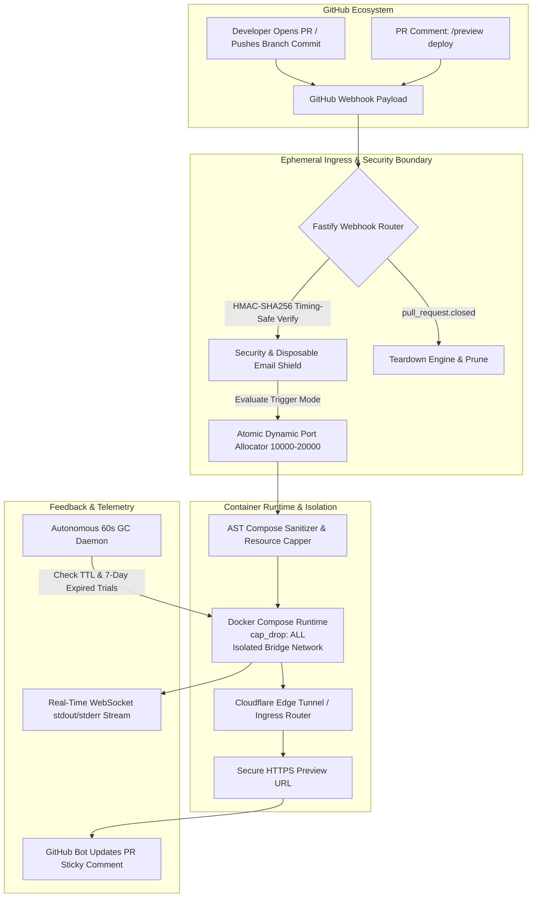
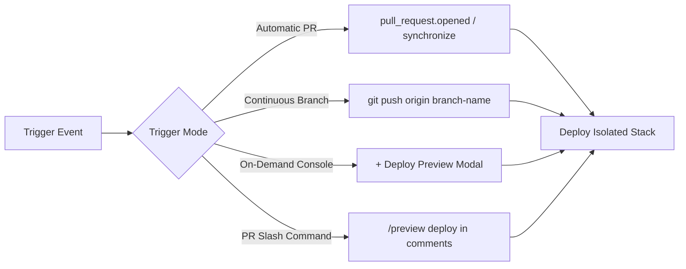

<div align="center">

# ⚡ Ephemeral

### The Autonomous, Multi-Tenant PR Preview Orchestrator for Full-Stack Docker Compose Apps

> *"Backend, full-stack, and infrastructure engineering teams deserve instant, zero-friction preview environments just like frontend developers."*

[-gold?style=for-the-badge&logo=github&logoColor=black)](https://github.com/mehaksandhudev)
[](https://ephemeral.peaklabs.in)
[](https://ephemeral.peaklabs.in)
[](https://paypal.me/mhksandhu)
[](https://buymeacoffee.com/mehaksandhudev)

[](https://www.typescriptlang.org/)
[](https://nodejs.org/)
[](https://www.docker.com/)
[](https://fastify.dev/)
[](https://react.dev/)
[](https://vitejs.dev/)
[](https://supabase.com/)
[](https://developers.cloudflare.com/cloudflare-one/connections/connect-networks/)
[](https://orm.drizzle.team/)
[](LICENSE)

**🌐 Live Production Platform:** [**https://ephemeral.peaklabs.in**](https://ephemeral.peaklabs.in)

[Live SaaS](https://ephemeral.peaklabs.in) • [Architecture](ARCHITECTURE.md) • [API Spec](API_SPEC.md) • [Security Policy](SECURITY.md) • [Terms & AUP](TERMS_AND_AUP.md) • [Privacy Policy](PRIVACY_POLICY.md) • [Demo Compose](docker-compose.yml)

</div>

---

## 📑 Table of Contents

- [⚡ Why Ephemeral?](#-why-ephemeral)
- [📊 Institutional Benchmark: Traditional Staging vs. Ephemeral](#-institutional-benchmark-traditional-staging-vs-ephemeral)
- [🏗 Architecture & How It Works](#-architecture--how-it-works)
- [🎯 Interactive In-PR Slash Commands](#-interactive-in-pr-slash-commands)
- [🚀 Key Features & Enterprise Capabilities](#-key-features--enterprise-capabilities)
- [🎯 Trigger Modes: PRs, Branch Commits & On-Demand](#-trigger-modes-prs-commits--on-demand)
- [💻 Languages & Engineering Stack](#-languages--engineering-stack)
- [💳 Subscription Tiers, 7-Day Spark Trial & Peer Billing](#-subscription-plans--7-day-trial)
- [🐳 Reference Docker Compose Architecture](#-reference-docker-compose-architecture)
- [📡 Complete API Reference](#-complete-api-reference)
- [📚 Documentation Hub & System Guides](#-documentation-hub--system-guides)
- [🛡 Security Hardening & Acceptable Use Policy](#-security--acceptable-use-policy)
- [📜 Legal Terms, Privacy Policy & Compliance](#-legal-terms--privacy-policy)
- [☕ Support & Donations](#-support--donations)
- [👩‍💻 Author](#-author)
- [📄 License & Disclaimer](#-license--disclaimer)

---

## ⚡ Why Ephemeral?

Frontend developers using Vercel or Netlify enjoy instant, isolated preview URLs on every Git branch. In contrast, teams building full-stack applications with databases (PostgreSQL, MySQL), caches (Redis), queues, workers, and APIs using Docker Compose face painful bottlenecks:

- **"Can you review my backend PR?"**: Reviewers are forced to pull branches locally, rebuild containers, configure environment variables, and run seed scripts (wasting 30–45 minutes per review).
- **Shared Staging Bottleneck**: Entire engineering teams queue up to test against a single shared staging server. One broken PR halts testing for everyone.
- **Prohibitive Cloud Preview Costs**: Commercial preview products (Bunnyshell, Uffizzi, Qovery) demand costly Kubernetes clusters (EKS/GKE) running at $500–$2,000+/month.
- **Resource Exhaustion**: Orphaned staging containers linger on host servers indefinitely, consuming CPU and RAM until the machine crashes.

**Ephemeral solves this by bringing instant, isolated, zero-Kubernetes preview environments to full-stack Docker Compose applications on any standard $10–$20 VPS.**

---

## 📊 Institutional Benchmark: Traditional Staging vs. Ephemeral

| Feature / Metric | Traditional Shared Staging | Cloud K8s Preview SaaS | ⚡ Ephemeral Preview Orchestrator |
| :--- | :--- | :--- | :--- |
| **Reviewer Experience** | Wait for staging slot or pull locally | Web URL (Slow K8s spinup ~5–10m) | **Instant HTTPS URL posted directly in PR (~30–45s)** |
| **Workload Scope** | Mixed (Frequent database collisions) | Full-stack (Requires Helm/K8s manifests) | **Native `docker-compose.yml` (Zero config needed)** |
| **Infrastructure Cost** | $100–$300/mo shared VM | $500–$2,500/mo (EKS/GKE + SaaS fees) | **Runs on a single $10–$20 VPS (0 Kubernetes)** |
| **Port Conflicts** | Frequent port clashes (`3000`, `5432`) | Complex Ingress / Traefik ingress configs | **Atomic dynamic port allocator (`10000–20000`)** |
| **Security Sandboxing** | Shared root container access | Cloud IAM / Network policies | **AST Compose sanitizer + capability drops + bridge isolation** |
| **Resource Hygiene** | Stale branches left running forever | Manual teardown scripts | **Dual GC: Auto-prunes on PR close + 60s Auto-TTL reaper** |
| **Trigger Control** | Manual CI/CD button | Pull requests only | **PRs + Branch Commits + UI On-Demand + Slash Commands** |
| **Public Access** | Complex firewall & port forwarding | Public load balancer | **Cloudflare Tunnel / Custom vanity domains with auto-SSL** |

---

## 🏗 Architecture & How It Works



---

## 🎯 Interactive In-PR Slash Commands

Maintainers and collaborators can manage previews directly from GitHub pull request discussion comments without leaving GitHub:

| Slash Command | Action Executed by Ephemeral Bot |
| :--- | :--- |
| `/preview deploy` | Immediately triggers an on-demand build of the pull request branch. |
| `/preview destroy` | Immediately tears down running preview containers and reclaims host ports. |
| `/preview logs` | Fetches the last 50 lines of container build/runtime logs and replies in the PR. |
| `/preview restart` | Gracefully restarts the container stack without rebuilding image caches. |
| `/preview extend 4h` | Extends the active preview's Time-To-Live (TTL) by 4 hours. |

---

## 🚀 Key Features & Enterprise Capabilities

- 🐳 **Native Full-Stack Docker Compose**: Supports multi-container stacks—web frontends, backend APIs, relational databases (Postgres/MySQL), caches (Redis), and background workers.
- ⚡ **Multi-Mode Trigger Automation**:
  - **Auto PR**: Automatic deployments on `pull_request.opened` and `synchronize`.
  - **Branch Push**: Continuous deployments for trunk-based development on direct branch pushes (`git push origin feature-branch`).
  - **On-Demand UI**: Deploy any PR, branch, or specific commit SHA with customized TTL via the web console.
  - **In-PR Slash Commands**: Manage previews directly from GitHub comments (`/preview deploy`, `/preview destroy`, `/preview logs`, `/preview restart`, `/preview extend 4h`).
- 🛡️ **AST-Level Compose Sanitization**: Deep parsing strips `privileged: true`, blocks host mounts to `/var/run/docker.sock` and root `/etc`, drops dangerous Linux capabilities, and enforces tier CPU/memory quotas.
- 🔢 **Atomic Dynamic Port Allocator**: Concurrency-safe SQLite transactional registry allocating conflict-free ports from `10000–20000` with host TCP socket validation.
- 🌐 **Zero-Config Public Ingress**: Instant public HTTPS URLs via Cloudflare Edge Tunnels or custom vanity domains (`pr-42.preview.yourcompany.com`) with automated CNAME verification.
- 💬 **Sticky Non-Spam GitHub Bot**: Updates a single preview comment in-place on new commits rather than cluttering pull request discussions.
- 📊 **Real-Time WebSocket Log Streamer**: Sub-millisecond container stdout/stderr build and execution inspection right in the dashboard.
- 🧹 **Dual Garbage Collection**:
  - Immediate teardown on PR close/merge: `docker compose down -v --rmi local`
  - Autonomous 60-second background reaper purging idle stacks and expired TTLs.
- 🔒 **Enterprise Anti-Abuse Gateway**: Blocks disposable and burner email domains (`mailinator.com`, `tempmail.com`, etc.) and enforces Cloudflare Turnstile CAPTCHA.
- 👥 **Multi-Tenant Team Roles**: Role-based access control (`Admin`, `Developer`, `Viewer`) with organizational seat caps.
- 🔔 **Instant Notification Channels**: Webhook dispatch to Slack, Discord, or custom endpoints on deployment status changes.

---

## 🎯 Trigger Modes (PRs, Commits & On-Demand)

Ephemeral accommodates any engineering workflow:



1. **Automatic Pull Request Trigger**: Spins up or updates preview environments automatically whenever a PR is created or synchronized.
2. **Direct Branch Push Trigger**: Previews specific feature branches on every commit push without requiring an open pull request.
3. **On-Demand Manual Trigger**: Use the **+ Deploy Preview** button in the dashboard to deploy any repository, branch, PR number, or specific commit SHA with a custom TTL buffer.
4. **Interactive In-PR Slash Commands**:
   - `/preview deploy` — Immediately queues or rebuilds the current pull request branch.
   - `/preview destroy` — Immediately tears down containers and reclaims ports.
   - `/preview logs` — Posts the latest 50 build/runtime log lines directly in the PR conversation.
   - `/preview restart` — Restarts containers without invalidating build caches.
   - `/preview extend 4h` — Extends the preview TTL by 4 hours.

---

## 💻 Languages & Engineering Stack

Ephemeral is built with a modern, high-performance polyglot engineering stack:

| Language / Format | Ecosystem & Version | Primary Purpose in Ephemeral |
| :--- | :--- | :--- |
| **TypeScript** | TypeScript 5.6+ | Type-safe backend Fastify API, container lifecycle orchestrators, and React 19 frontend components. |
| **JavaScript / Node.js** | Node.js 20+ LTS | Core runtime execution, asynchronous task queues, WebSocket log streaming, and subprocessor integrations. |
| **React** | React 19 (ESM) | Responsive dashboard HUD, modal suites, live countdowns, and glassmorphism UI state management. |
| **CSS3 & Tailwind** | Tailwind CSS + Custom HUD | Glassmorphism design tokens, dark/light theme switching, and responsive mobile drawers. |
| **SQL** | SQLite 3 (WAL Mode) + Drizzle | Microsecond-latency persistent database for environments, atomic port registry, and tenant isolation. |
| **YAML** | Docker Compose v2/v3 Specs | Declarative multi-container definitions, parsed and sanitized via AST parser. |
| **Shell / PowerShell** | Bash & PowerShell 5.1/7+ | Production daemon management, systemd services, test suites, and deployment scripts. |
| **HTML5** | Modern Semantic HTML | Standalone legal terms (`/terms.html`), privacy policy (`/privacy.html`), and competitive reports. |

---

## 💳 Subscription Plans & 7-Day Trial

| Plan Tier | Price | Concurrent Previews | Hardware Quotas | Ingress Routing | TTL / Idle Policy |
| :--- | :--- | :--- | :--- | :--- | :--- |
| **Spark (Trial)** | **Free (7 Days)** | 2 Previews | 1 vCPU / 2GB RAM | Shared Subdomain | 4h TTL / 30m Idle |
| **Vapor** | **$39 / mo** | 6 Previews | 2 vCPU / 4GB RAM | Vanity Ingress + SSL | 12h TTL / 45m Idle |
| **Stratum** | **$129 / mo** | 20 Previews | 4 vCPU / 8GB RAM | Custom Domains + Wildcard | 24h TTL / 3h Idle |
| **Apex** | **$349 / mo** | Unlimited | Dedicated 8 vCPU / 16GB | Dedicated VPC Runner | Indefinite / Always-on |

### 7-Day Spark Free Trial & Peer Payment Lifecycle
- **Day 1 to 7**: Full access to 2 concurrent preview environments on the Spark tier.
- **Day 7 (Trial Expiry)**: The account automatically locks (`isTrialExpired = true`). Active containers are paused, and deploying new previews requires an upgrade.
- **Direct Peer Payments**: Upgrade securely via direct peer payment:
  - **PayPal.Me**: [paypal.me/mhksandhu](https://paypal.me/mhksandhu)
  - **UPI VPA**: `ephemeral@okaxis`
- **Instant Claim Verification**: Enter your transaction reference ID in the billing modal for verification and immediate account unlocking. Data is preserved for 14 days post-lockout.

---

## 🐳 Reference Docker Compose Architecture

This repository uses a self-contained multi-tier definition in [`docker-compose.yml`](docker-compose.yml):

```yaml
services:
  web:
    image: nginxdemos/hello:plain-text
    ports:
      - "80"
```

Ephemeral automatically detects exposed ports, dynamically rewrites host bindings to an unallocated port in the `10000–20000` pool, and routes incoming traffic securely.

---

## 📡 Complete API Reference

| Method | Endpoint | Description |
| :--- | :--- | :--- |
| `GET` | `/api/health` | System health check, container counts, and daemon status |
| `GET` | `/api/environments` | List all active preview environments with filters |
| `GET` | `/api/environments/:id` | Fetch specific preview environment details and assigned ports |
| `POST` | `/api/environments/trigger` | Manually deploy preview for PR #, branch, or commit SHA |
| `POST` | `/api/environments/:id/destroy` | Manually terminate environment and release allocated ports |
| `POST` | `/api/environments/:id/redeploy` | Trigger clean rebuild with the latest commit |
| `GET` | `/api/environments/:id/logs` | Fetch recent container stdout/stderr build logs |
| `WS` | `/api/environments/:id/logs/stream` | WebSocket connection for real-time log streaming |
| `GET` | `/api/domains` | List verified custom vanity domains |
| `POST` | `/api/domains` | Register a new custom vanity domain |
| `POST` | `/api/domains/:id/verify` | Trigger real-time DNS CNAME resolution check |
| `GET` | `/api/billing/org/:orgId` | Fetch current organization subscription, trial countdown, and lock state |
| `POST` | `/api/billing/manual-claim` | Submit PayPal.Me or UPI peer payment verification claim |
| `POST` | `/api/webhook/github` | Public webhook ingress for GitHub App events |

*For complete request schemas, response codes, and WebSocket frame structures, consult [`API_SPEC.md`](API_SPEC.md).*

---

## 📚 Documentation Hub & System Guides

All core architecture, API specifications, and legal policies are bundled directly in this repository:

| Document | Scope & Focus | Target Audience | Direct Link |
| :--- | :--- | :--- | :--- |
| **System Architecture** | Subsystem breakdown, AST compose sanitizer, atomic port pool (`10000–20000`), GC reaper daemon, sequence diagrams. | Architects & Core Engineers | [`ARCHITECTURE.md`](ARCHITECTURE.md) |
| **API Specification** | Full REST endpoints, WebSocket log stream schemas, trigger endpoints, error codes, and billing webhooks. | Integrators & Frontend Devs | [`API_SPEC.md`](API_SPEC.md) |
| **Security Policy & AUP** | Vulnerability disclosure SLAs, container escape mitigations, rootless gVisor isolation, disposable email filtering. | Security Researchers & SecOps | [`SECURITY.md`](SECURITY.md) |
| **Terms of Service & AUP** | Comprehensive 13-section enterprise legal contract, acceptable use, peer payment policies, arbitration. | Legal & Compliance Teams | [`TERMS_AND_AUP.md`](TERMS_AND_AUP.md) |
| **Privacy Policy** | GDPR, CCPA, and India DPDP compliance, zero source code persistence guarantees, subprocessor disclosures. | Data Protection Officers | [`PRIVACY_POLICY.md`](PRIVACY_POLICY.md) |
| **Docker Compose Spec** | Lightweight, clean test service manifest for running automated preview pipelines. | Maintainers & Testers | [`docker-compose.yml`](docker-compose.yml) |

---

## 🛡 Security & Acceptable Use Policy

Ephemeral enforces institutional-grade defense-in-depth:
- **Dropped Kernel Capabilities**: Workloads operate with unprivileged capabilities to prevent container breakout exploits.
- **AST Compose Sanitizer**: Rejects bind mounts to `/var/run/docker.sock`, root `/`, and `/etc`.
- **Atomic Port Allocator**: Prevents port contention or port hijacking across tenant previews.
- **Untrusted Fork PR Gating**: PRs from public forks require explicit repo collaborator approval before deployment.
- **Strict Anti-Abuse Gating**: Automated blocking of disposable email addresses and Cloudflare Turnstile CAPTCHA.
- **Zero Tolerance AUP**: Immediate termination of accounts attempting cryptocurrency mining, network scanning, DDoS, or malicious activities.

Read the full [Terms of Service & AUP](TERMS_AND_AUP.md) and [Security Policy](SECURITY.md).

---

## 📜 Legal Terms & Privacy Policy

- **Terms of Service & AUP**: [TERMS_AND_AUP.md](TERMS_AND_AUP.md) • [Web View](https://ephemeral.peaklabs.in/terms.html)
- **Privacy Policy (GDPR / CCPA / DPDP)**: [PRIVACY_POLICY.md](PRIVACY_POLICY.md) • [Web View](https://ephemeral.peaklabs.in/privacy.html)
- **Competitive Benchmark Analysis**: [Web Report](https://ephemeral.peaklabs.in/ephemeral-competitive-analysis.html) • [PDF Whitepaper](https://ephemeral.peaklabs.in/ephemeral-competitive-analysis.pdf)

---

## ☕ Support & Donations

If Ephemeral saves your engineering team hours of manual staging maintenance, accelerates your code reviews, or simplifies your preview infrastructure, consider supporting development:

[](https://paypal.me/mhksandhu)
[](https://buymeacoffee.com/mehaksandhudev)

- **PayPal**: [https://paypal.me/mhksandhu](https://paypal.me/mhksandhu)
- **Buy Me A Coffee**: [https://buymeacoffee.com/mehaksandhudev](https://buymeacoffee.com/mehaksandhudev)
- **UPI (India)**: `ephemeral@okaxis`

---

## 👩‍💻 Author

**Mehak Sandhu**  
*Full-Stack Systems Architect & Quantitative Engineer*  
*Amritsar, Punjab, India 🇮🇳*

- 🌐 **Portfolio**: [mehak-sandhu.in](https://www.mehak-sandhu.in)
- 🐙 **GitHub**: [@mehaksandhudev](https://github.com/mehaksandhudev)
- 📧 **Contact**: [mehaksandhudev@gmail.com](mailto:mehaksandhudev@gmail.com) • [info@mehak-sandhu.in](mailto:info@mehak-sandhu.in)

---

## 📄 License & Disclaimer

Distributed under the **MIT License**. See [`LICENSE`](LICENSE) for details.

> **Disclaimer**: Ephemeral is an autonomous container orchestrator. Users are responsible for container workloads executed within their repositories. Ensure your Docker Compose configurations comply with applicable legal frameworks and the [Acceptable Use Policy](TERMS_AND_AUP.md).

---

<div align="center">

Crafted with ❤️ by **[Mehak Sandhu](https://github.com/mehaksandhudev)** • [Portfolio](https://www.mehak-sandhu.in) • [Live Platform](https://ephemeral.peaklabs.in)

</div>
